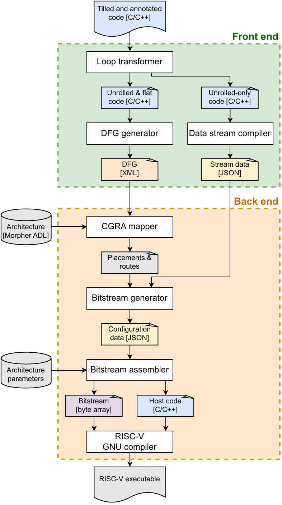

# StreamFlow

**Compiler framework for the [BubbleTea](https://github.com/joaofbmaia/bubbletea) stream-driven CGRA.**

StreamFlow takes a C loop nest marked for acceleration and produces what BubbleTea needs to run it:

- the **data-stream descriptors** that the streaming engine uses to load operands and store results;
- the **dataflow graph**, mapped onto the CGRA in space and time;
- a **configuration bitstream** and **host code** for the RISC-V core.

One command runs the whole flow.



## How it works

**Front end** (architecture-independent)

1. **Loop transformer.** [Clava](https://github.com/specs-feup/clava) source-to-source scripts unroll the tile below the pragma and flatten the loops above it.
2. **DFG generator.** An LLVM pass extracts the dataflow graph of the unrolled loop body. It is a fork of Morpher's DFG generator, adapted to the stream model.
3. **Data stream compiler.** Recovers each array's memory access pattern as a multi-dimensional affine stream descriptor.

**Back end** (architecture-specific)

4. **CGRA mapper.** Modulo-schedules the DFG onto the mesh, assigning each operation a PE and a cycle. It is a fork of Morpher's mapper.
5. **Bitstream generator and assembler.** Combine placements, routes and stream descriptors into a configuration bitstream plus host code. The assembler is part of the [BubbleTea](https://github.com/joaofbmaia/bubbletea) repository.
6. The **RISC-V GNU toolchain** builds the final executable.

## Writing a kernel

Tile the loop nest by hand and put `#pragma cgra_map` above the tile. Loops above the pragma become stream dimensions; the tile below it is unrolled into the dataflow graph.

```c
#define N 1024
#define TILE_SIZE 2

void kernel_jacobi_2d() {
  for (int i = 0; i < N; i += TILE_SIZE) {
    for (int j = 0; j < N; j += TILE_SIZE) {
      #pragma cgra_map
      for (int ii = 0; ii < TILE_SIZE; ii++) {
        for (int jj = 0; jj < TILE_SIZE; jj++) {
          B[i + ii][j + jj] =
              0.2f * (A[i + ii][j + jj] + A[i + ii][j + jj - 1] +
                      A[i + ii][j + jj + 1] + A[i + ii - 1][j + jj] +
                      A[i + ii + 1][j + jj]);
        }
      }
    }
  }
}
```

More examples are in `benchmarks/my_benchmarks/`.

## Setup

```bash
git clone --recursive https://github.com/joaofbmaia/streamflow.git
cd streamflow
./init_script.sh   # downloads Clava, builds LLVM 10 (with Polly), the DFG generator and the mapper
```

Building LLVM takes a while. Graphviz is needed to render DFGs.

## Usage

```bash
./run_streamflow.py path/to/kernel.c kernel_function_name
```

Each stage writes its output next to the source file (`0_unrolled_code/`, `1_flattened_code/`, `2_morpher_formatted_code/`, `3_dfg_gen_output/`, `4_cgra_mapper_output/`).

## Reference

> J. Maia, **"Stream-based Coarse-Grained Reconfigurable Accelerator"**, MSc thesis, Instituto Superior Técnico, 2025. Supervised by P. Tomás and N. Roma. [[Record]](https://scholar.tecnico.ulisboa.pt/records/q6Wju__CshOqaxesH3UP-CUDHal3EJJy20WS) [[PDF]](https://scholar.tecnico.ulisboa.pt/api/records/q6Wju__CshOqaxesH3UP-CUDHal3EJJy20WS/file/14a4768311b9258c6883ac82405e130e8df23b1b5560c0ca9e6b9eb3461c8d2e.pdf)
>
> J. Maia, A. Silveira, G. Midões, N. Neves, P. Tomás, N. Roma, **"Stream-Driven Acceleration for Embedded RISC-V SoCs"**, IEEE ISCAS 2025. [[IEEE Xplore]](https://ieeexplore.ieee.org/document/11043244/)

The DFG generator and CGRA mapper build on [Morpher](https://github.com/ecolab-nus/Morpher_CGRA_Mapper) (NUS ECoLab).
